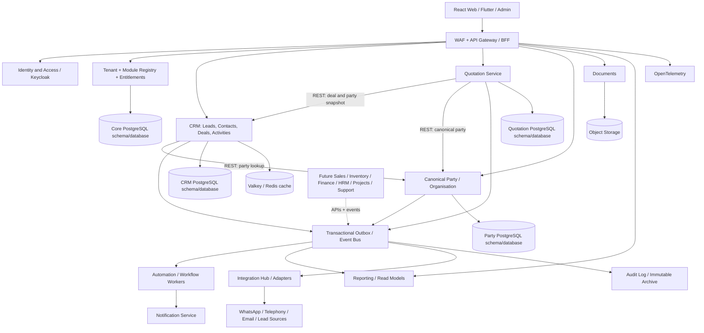
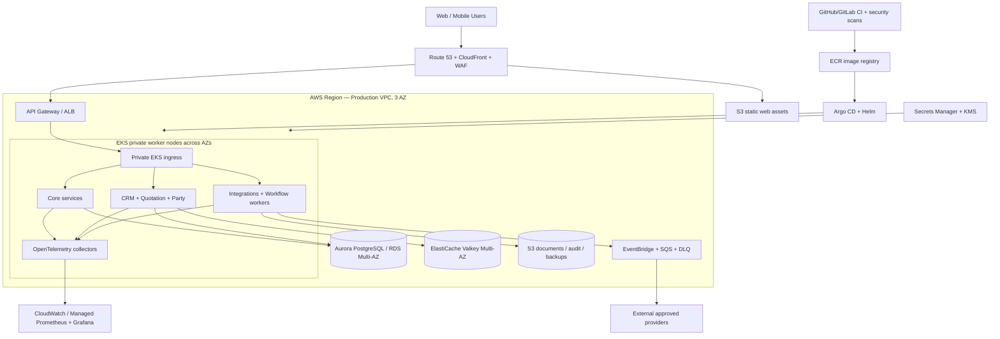
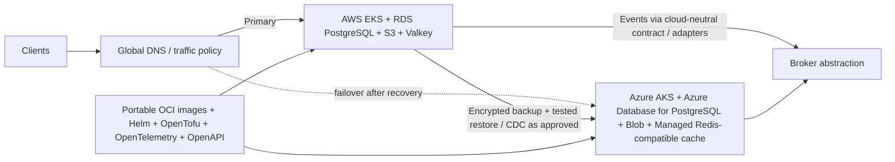
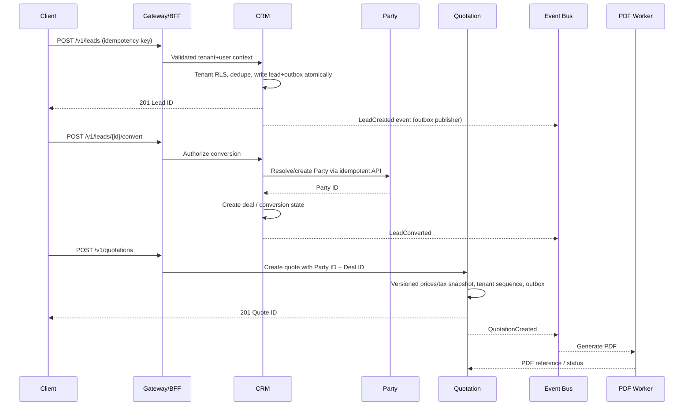

# ERP SRS v1.2 — AWS-first microservices architecture

## Logical microservices

## AWS infrastructure

## Multi-cloud expansion (active-passive recommended first)

## Lead-to-quotation workflow

## Implementation notes
- Source baseline prefers modular monolith, NestJS/TypeScript, RabbitMQ and Valkey. Spring Boot, EKS and AWS-managed messaging are proposed alternatives, requiring architecture decision records.
- Prefer a small number of deployable services initially: Core/Entitlements, Party, CRM, Quotation, Integration Hub and asynchronous workers. Separate audit, notification, search and reporting as load/ownership justifies.
- Each service owns tables and migrations; shared RDS cluster with separate schemas/roles initially is acceptable, but no cross-service table access. Tenant RLS and application authorization both mandatory.
- Never accept client-supplied tenant context without validating authenticated membership. Apply entitlement enforcement to REST, consumers, jobs, exports, search, files and cache.
- Use outbox + idempotent inbox + retry/backoff + DLQ; Sagas only for multi-step business transactions. Eventual consistency requires reconciliation and repair tooling.
- Cache-aside for read-heavy, non-sensitive data; tenant/module/permission-scoped keys, short TTLs, explicit invalidation. No cache as system of record.
- Synchronous calls: timeouts, bounded retries with jitter only for safe operations, circuit breaker, bulkheads, trace propagation, API versioning and contract tests.
- Multi-cloud portability is not simultaneous multi-cloud writes: start with AWS production, Azure recovery pilot, encrypted replicated backups and recovery drills; RPO/RTO need confirmation.
- Baseline assumptions from SRS: 100 tenants, 500 concurrent users, 99.5% availability, RPO 15 min, RTO 4 h; proposed targets requiring sign-off.
